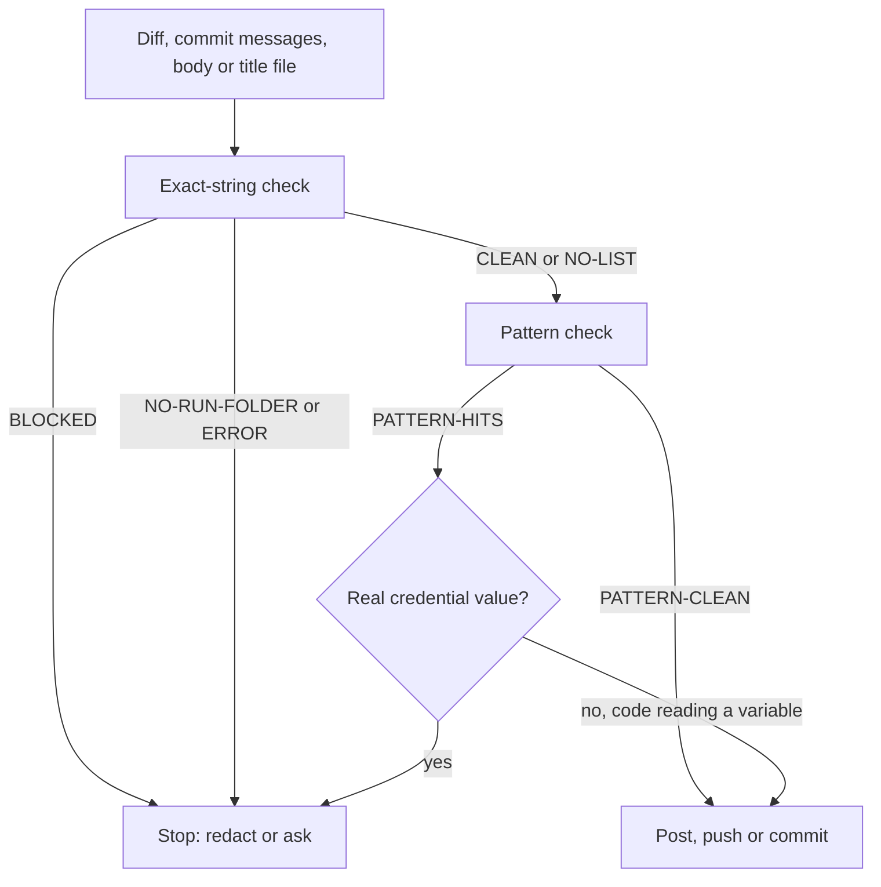

# Gates and checks

A gate is a step that must print its pass word before the next step runs. Silence is never a pass. In 1.6.4 three safeguards that used to be prose became real checks: the redaction script, the label, diagram and gap snippets that exit 1, and the zero-checks rule for CI.

## The redaction gate

Runs before any push, commit, issue create, comment, body edit, PR create or `--body-file`. The rules are in `references/redaction.md`; the script is `references/redact-check.py`.

```bash
python3 -I '<skill dir>/references/redact-check.py' --run "$HOME/.superfix/runs/<run-key>" -- <files>
```

It prints the exact-string word first, then the pattern word.

| Word | Meaning | What you do |
|---|---|---|
| `CLEAN` | no session credential is in those files | go on to the pattern word |
| `BLOCKED <files>` | a session credential is in the named files | post, push and commit nothing; replace it with `[redacted]` in a comment, body, title or message, then run again |
| `NO-LIST` | the run folder and its key file exist, but the secret list is missing or empty | a pass only in that case; run the pattern check anyway |
| `NO-RUN-FOLDER <folder>` | the run folder or its key file is missing | treat it as an error and stop; rebuild the key from the facts |
| `PATTERN-CLEAN` | no pattern hit | go on |
| `PATTERN-HITS` | the file and line of each hit | decide each one |

The script exits 1 on `BLOCKED`, `ERROR` and `NO-RUN-FOLDER`. A missing input file is `ERROR`, never `PATTERN-CLEAN`.



What the pattern check looks for: `password`, `passwd`, `pwd`, `secret`, `token`, `api_key`, `auth`, `bearer`, `cookie` or `session` followed by `:` or `=` and a value; prefixes `sk-`, `ghp_`, `gho_`, `github_pat_`, `AKIA` plus 16 characters, a JWT, a private key header, a URL with a user and password; and runs of 32 or more mixed letters and digits.

A real credential in a comment, body or message is replaced with `[redacted]`, added to the session list, and both checks run again. Never write `[redacted]` into source code: a real credential in the diff means the code is wrong, so stop and ask. A hit that is plainly code reading a variable stays. The allowlist is 40-hex strings, a string `git cat-file -e` resolves, 24-hex Qik record ids next to `_id` or `/goto/`, and 64-hex strings next to `sha256`.

`NO-LIST` passes only when the run folder exists. The script never prints the matching line, only the file name, so the secret does not land in the transcript. Every post uses `--body-file`. A title from chat is written to a file and checked first. A gate written during a run gets a failing-input test: missing files, a planted secret and no run folder.

## The label gate

The labels follow the Status line. "Waiting for you", "Stopped" and "Ready for review" mean `superfix:awaiting-decision`; "Fixing" means `superfix:approved`; "Diagnosing" and "Done" mean neither.

Before the first label, a permission check prints one word:

- `LABELS-OK`.
- `LABELS-SKIPPED not-owner`.
- `LABELS-SKIPPED hooks`, when the repo has a webhook or the hook list cannot be read.
- `LABELS-SKIPPED workflows`, with a `FLAG` or `UNREAD` line for each workflow that could react to issues or labels.
- `LABELS-SKIPPED could-not-list-files`.

Then each command prints one word and is never silenced: `LABEL-EXISTS` or `LABEL-CREATED` or `LABEL-CREATE-FAILED`; `LABEL-ADDED` or `LABEL-ADD-FAILED`; `LABEL-REMOVED`, `LABEL-REMOVE-FAILED` or `LABEL-NOT-PRESENT`; `LABELS-NOW <list>` or `LABELS-READ-FAILED`.

The create, add and remove snippets exit 1 on their failure word. The order is add the new label, then remove the old one, then read back, so the issue is never unlabelled in between. Labels are not a reason to stop: when the permission check skips them, the `Labels:` line says `not set (<word>)` and the body carries a hidden marker, `<!-- marker superfix-awaiting-decision -->` or `<!-- marker superfix-approved -->`.

## The diagram gate

The diagram question comes only when all of these hold: Moderate or Complex, 3 or more parts interact, the problem will be fixed, and there is an issue on a private repo. It never applies to Simple, the fast lane, an "Everything else" problem or a one-line fix.

After a yes, the source check runs before rendering. It prints `DIAGRAM-SOURCE-CLEAN` or `DIAGRAM-SOURCE-BLOCKED` with `exact`, `pattern`, `self-check`, `boxes N`, `missing` or `normalise`.

- The exact-string check runs on the file, a normalised copy and a copy with spaces removed.
- The pattern check runs on the file and the normalised copy, with `/Users/` paths, `~/` paths and URLs with a query string checked in the shown text.
- The diagram skill's own check script must print `OK`.
- The file must hold 1 to 9 `data-sf-node` groups.

A pattern hit blocks the diagram; there is no "you decide" for diagrams. The render step prints `SAVED`, `NO-SVG`, `UNREACHABLE`, `ERROR boxes <n>` or `ERROR <reason>`. The upload command prints `DIAGRAM-UPLOADED`, `DIAGRAM-KEPT`, `DIAGRAM-NOT-UPLOADED`, `NOT-PRIVATE`, `NO-OCR` or `HELD`. Any entry in the session list holds every diagram on the Mac until you say "post the pictures". The `Diagram:` line in the decision and final comments reports `ASKED`, `NONE`, `POSTED`, `NO`, `HELD`, `LOCAL` or `NOT-POSTED` with the reason.

## The gap gate

A gap note records a kind of problem Superfix does not cover, never your problem itself. It is written before the decision comment, in the checked private gap repo or in `~/.superfix/gaps/`.

The note check prints `GAP-NOTE-CLEAN` or `GAP-NOTE-BLOCKED` with `exact`, `names`, `pattern`, `missing` or `normalise`. It normalises the text, then checks the exact-string list, then names: the work repo's owner and name, the run key and the issue number are blocked. It also checks patterns, `/Users/` and `~/` paths, e-mail addresses, any URL and `owner/repo` shapes. A block is rewritten more generically; a second block sends the note to the local folder, never to a repo; a third block writes no note.

The gap repo check must print `GAP-REPO-OK`. Any other word sends the note to the local folder: `GAP-REPO-UNSET`, `GAP-REPO-BAD-NAME`, `GAP-REPO-REFUSED` (the gap repo is the work repo), `GAP-REPO-MISSING`, `GAP-REPO-NOT-OWNED`, `GAP-REPO-NOT-PRIVATE`, `GAP-REPO-SHARED`, `GAP-REPO-HOOKS`, `GAP-REPO-WORKFLOWS`, `GAP-REPO-APPS-UNCHECKED`.

The check needs the owner's dated `gap_repo_no_apps=<owner>/<gap repo> <YYYY-MM-DD>` line in `~/.superfix/config` for the same repo, dated within 90 days. A gap gate never stops the run: a blocked note falls back to the local folder and the run goes on. A problem with checks proposed gets no note at all.

## The comment gate (1.6.2)

Before a comment goes onto the issue, `wo-scan-comment` scans it and `wo-post` refuses to open the gate for a comment that was not scanned.

- The scan needs `--data <file>` (the owner's original) or `--no-data`. With neither, or with an empty list, it stops with `SCAN-NO-DATA`, writes no receipt, and the post is refused.
- The receipt is written whole and records the sha of the comment and of the data file. `wo-post` refuses a cut-short receipt, a changed comment and a changed data file.
- The comment's own file name is scanned, and each cell of a tab separated file is read on its own.
- The Stop gate comment and the final comment of either work order kind go through the same two commands.

The post is allowed only when `wo-post` prints `POST-OK`, or `POST-OK-DECLARED` when the run holds no data file and says so with `--no-data`. Scan first, post second, clean up third: a cleanup between the scan and the post takes the receipt away and the post is refused.

The gate detects; it does not prevent. The model still posts with `gh issue comment`, so a model that skips the gate and posts anyway is not stopped by the tool. The order is written in `references/workorder.md`, which is read less reliably than `SKILL.md`, so the live gates check the order after the fact.

In criteria mode the same post also needs `LINES-OK` and `CRITERIA-OK`, and carries the public line `attempts: <n> lines, head <8 hex>`.

## The settings reader (1.6.3)

`references/project.py` reads `<repo>/.superfix/project.md` once, in Phase 0, and prints one item per line. It never runs a command: a checks command is validated, not executed.

| Output | Exit | What the run does |
|---|---|---|
| `PROJECT-OK` | 0 | applies every `SETTING` line |
| `PROJECT-UNKNOWN-KEY <key>` | 0 | applies the rest, shows `IGNORED <key>`, continues |
| `PROJECT-REFUSED <key>` | 1 | stops and asks at the Stop gate |
| `PROJECT-CHECK-REFUSED <key>` | 1 | stops and asks at the Stop gate |
| `PROJECT-BAD-VALUE <key>` | 1 | stops and asks at the Stop gate |
| `SETTINGS-NONE` | 0 | no file, or no settings: nothing changes |

Then one `SETTING <key>=<value>` per applied value, in file order. A refused value is echoed back cut to 60 characters. The five keys are `base-branch`, `pr-base`, `checks`, `rules` and `do-not-edit`. Any key or `rules` line naming a safeguard is refused, as is any `checks` command outside the narrow allowlist and any value naming a credential path or an outbound destination.

The settings are read once. A repo that changes its own settings file during a run is not re-read between the go and the fix; that window is known and unguarded. `pr-base` is carried into the PR command, but the PR is opened by a third-party skill at Phase 4, so the base is not enforced by the reader.

## The solved check (runs 1 to 3)

The check runs inside verification, on both code paths. `<s1>` and `<s3>` are new folders outside the repo, made with `mktemp -d`.

```bash
git worktree add --detach <s1> <approval-sha>
git -C <s1> checkout <branch> -- <new or changed test paths>
# run 1 in <s1>: must fail through the named guard
# run 2: the same check on the branch: must pass
git worktree add --detach <s3> HEAD
git -C <s3> checkout <approval-sha> -- <fix files that existed, no test paths>
git -C <s3> rm -q -f -- <files the fix added>
# run 3 in <s3>: must fail through the same named guard
```

- Run 1 uses the approval commit with the new tests brought in. It must fail, and the expected failing guard is named and its line checked.
- Run 2 runs the same check on the branch. It must pass, and the owner's quoted description must no longer hold.
- Run 3 uses the branch head with the fix's own files reverted: modified files are restored from the approval commit, added files are removed. It must fail through the same guard.

Run 3 is not applicable to a behaviour-keeping refactor, or to a brand-new module or feature where taking the code out cannot fail meaningfully. It is then listed under Not tested and is not counted as a pass. If run 3 passes, the check does not detect the problem: fix the check, not the code, and run all three again.

After each run, and whenever a step fails: `git worktree remove --force <path>; git worktree prune`.

## The CRIT-1.5 guard

The 1.5.0 commands in `references/crit.py` must stay byte identical. The guard is `tests/crit-15-check.py`.

```bash
python3 tests/crit-15-check.py skills/superfix/references/crit.py
```

It compares every top-level function except the work order commands and their helpers, `main()` except the contiguous work order parser block, and every other line of the tool except the constants it names. The skipped regions use exact AST boundaries, so a line smuggled between two functions is still compared. A skipped helper must have no decorators and only constant defaults.

It prints `CRIT-1.5-CHANGED <names>` and exits 1 on any difference, or `CRIT-1.5-UNCHANGED`. The 1.6.1 baseline is 106 functions.

## The repo checks

These are the free checks, run before a PR and in CI where the workflow names them.

- `tests/preservation-check.py` lists every line of the last release tag that is gone or moved, and fails on an unexplained one.
- `tests/project-tests.sh`, 52 settings tests.
- `tests/workorder-tests.sh`, 115 work order tests.
- `tests/workorder-criteria-tests.sh`, 240 criteria work order tests.
- `tests/redact-check-tests.sh`, 16 redaction gate tests.
- `tests/solved-close-tests.sh`, 11 solved check, merged tree, zero checks and closing tests.
- `tests/skill-text-tests.sh`, 29 skill text tests.

The CI workflow `.github/workflows/skill-sync-check.yml` runs the sync check, the preservation check, the `workorder.md` and `criteria.md` line caps, the CRIT-1.5 guard and the settings tests on a PR that touches the skill files. The work order, criteria, redaction, solved check and skill text tests are not in CI.
