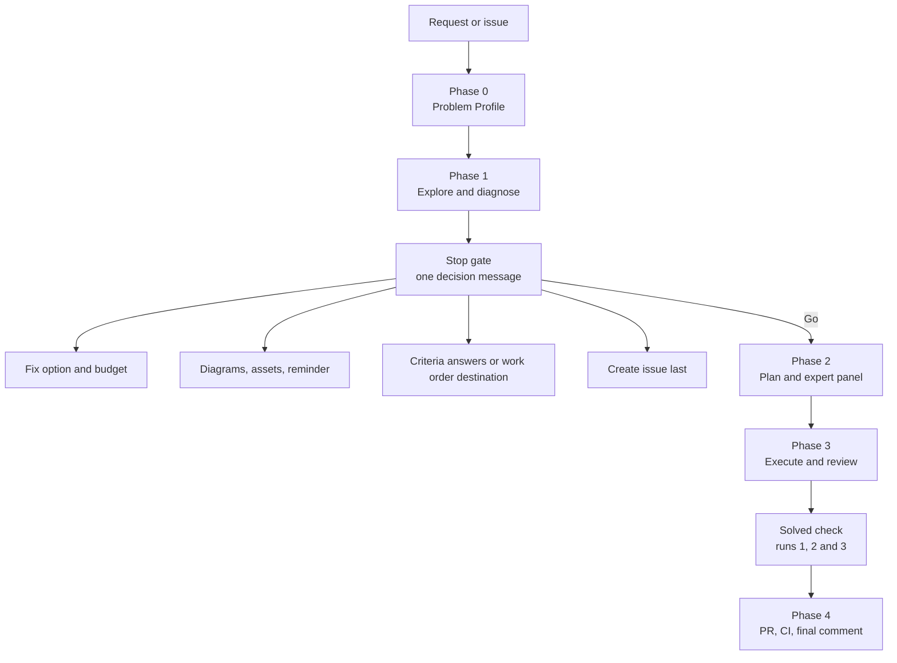
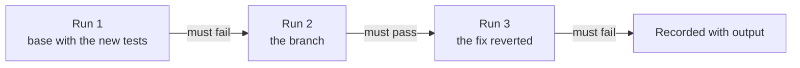

# How a run works

A Superfix run starts with a GitHub issue number or a plain description and ends with an opened pull request, its checks green, and a final comment on the issue. On the way it reads the problem, finds the cause, stops once for your decision, then fixes and proves the fix.

The plain version: you describe the problem, Superfix tells you what it thinks is wrong and what it proposes, you answer once, and it does the work. The technical version is below.

## The flow

The Stop gate is the only pause. Every question for the run is in that one message, numbered, with a recommended answer except where the rules say otherwise.

## Phase 0: the Problem Profile

Superfix reads the whole input first: the body, every label and every comment. It never classifies from the title alone.

The coverage check runs before the type. It decides which kind of problem this is and quotes the words that made it decide.

| Coverage | Matches when the report mentions | What Superfix can do |
|---|---|---|
| Code | source, tests, build or config files in the repo, including markdown a program reads; a wrong command, sample, link or version in a README or docs page; a stack trace or command output from the repo | diagnose and fix |
| Qik configuration | a Qik interface, section, form, role, workflow, definition, a qik.dev link | diagnose and fix in the draft only, marked provisional |
| Everything else | prose files when the problem is only how they are written; documents, process, sheets, business | diagnose; criteria mode for a data or document clean-up; a process gets a draft only |

Then the type, in priority order: security, bug, performance, ux, architecture, feature, research. A report with two types sets a primary and a secondary type and merges their skill lists.

A `research` run asks questions and changes nothing: no branch and no PR. Its output is a report on the issue, and one validation agent checks every claim in it first, as `CONFIRMED`, `CORRECTED` or `REFUTED`. The rules are in `references/research.md`.

The complexity tier is provisional here and confirmed after exploration: Simple, Moderate or Complex. It can be upgraded, never downgraded.

The Problem Profile has these fields:

- Coverage, with the quoted trigger and one piece of evidence.
- Settings, from the repo's `.superfix/project.md`, read by `references/project.py`.
- Primary type and optional secondary type.
- Complexity tier.
- Skill manifest and the expert panel and agent execution flags.

The Profile is not posted on its own. It goes into the AI detail of the one decision message at the Stop gate. With no issue, the same record goes in the file-mode journal under `~/.superfix/journal/`, outside the repo.

## Phase 1: explore and diagnose

Diagnosis runs before any code is written. The method is in `references/diagnose.md` and the type-specific exploration is in `references/explore.md`.

1. Run one check that fails on the reported symptom. Paste its output. For a feature, use the acceptance check that fails because the feature is absent. No failing check, no hypotheses.
2. Separate what was observed, each with the command that showed it, from what is inferred.
3. Write 3 to 5 ranked hypotheses. Each has a prediction that would prove it wrong. Test the cheapest discriminating prediction first.
4. Call the cause confirmed only when a filled row shows one hypothesis predicts the observation and the others do not. Anything less is "suspected".
5. Search for the same cause elsewhere and list the siblings.
6. Diagnose only what explains the reported symptom. Anything else goes under "Seen, not diagnosed".
7. Self-audit every claim before the stop: was evidence skipped, misread or missing? Fix it or downgrade it to "suspected".

The stop rules: a confirmed cause, three falsified hypotheses with nothing left that fits, or about 30 minutes without a failing check. Then the run goes to the Stop gate and asks for the environment, account, data or file it needs.

Before approval the only writes allowed are the journal, a scratch folder outside the repo, a detached worktree inside it, the Superfix labels, and gap notes in the checked private gap repo or the local gap folder. Evidence pictures are uploaded only to a private repo through the upload gate. Diagrams wait for the go.

Since 1.6.4, every count, line number and earlier-issue claim in the issue is a hypothesis: Superfix re-derives it against the repo and writes "issue said X, measured Y" when the numbers differ. Every scan carries a positive control with a known nonzero count.

The phase ends with `## Problems` in the issue body: symptom, failing check and output, baseline for performance, cause, ruled out, siblings, tools used and missing.

## The Stop gate

The issue body is updated before the decision comment is posted. It carries the Status line, `## Problems`, `## Options` and `## Done when`, plus the reporter's text under `## Original report`. The `## Done when` section quotes the owner's description of the problem; that quote is the acceptance criterion.

Then one comment holds every question for the run, numbered, each with a recommended answer, its effort and the budget. "Keep executing" means yes to every question that has a recommended answer. The create-issue question and the `assets` release question have no recommendation: anything but an explicit yes is no.

Where Superfix asks, in one decision message:

- The fix option, for each problem, with a recommendation.
- The budget in plain words, for example "Up to 2 hours, touching these 3 files".
- The two criteria questions, once for all criteria-mode problems, with no recommended answer.
- The sandbox question, when the measure scripts cannot run in the macOS sandbox; this one is asked first and alone.
- The commit question, only on a private repo, for a criteria-mode file.
- The diagram question for Moderate or Complex work where 3 or more parts interact.
- The work order destination, right after the budget question.
- The reminder question for a `later` criterion.
- The `assets` release question when pictures need it.
- The create-issue question, always last when there is no issue.

On a go, Superfix writes `## Decision` in its own words, never pasting your reply, sets Status to "Fixing problem 1 of N", and records the approval commit. The work branch starts from that commit, so later commits on main do not count against the budget or the solved check.

## Phase 2: plan

Moderate and Complex work gets a design step by type, a written plan and a context file. The plan goes to `docs/superpowers/plans/YYYY-MM-DD-<slug>.md`; the context file is `docs/superpowers/plans/<slug>-context.md`. Every execution subagent reads the context file.

An expert panel reviews the plan before implementation. The finding format is must-fix, should-fix and a verdict only. Must-fix findings are resolved before implementation and the plan is updated. There are at most two panel passes; anything unresolved after the second goes back to the owner with specific questions.

Simple work has no plan and goes straight to Phase 3 after the go.

## Phase 3: execute

The branch is created from the approval commit, not from a newer main. The Simple path runs inline on the main thread. Moderate and Complex work dispatches an agent with the context file, the plan, the budget and the approval commit.

Every code path writes the failing test first where the type calls for it, implements, runs the impacted tests, simplifies, re-runs the tests, then reviews. The review rules are in `references/execute.md`:

- A review agent is report-only. After it returns, `git status --porcelain` must show no change it made.
- Fix every high-confidence finding, one issue and one fix at a time, then re-verify.
- At most two review passes over the full diff. If high-confidence issues remain, escalate.
- `code-security-audit` runs after the code reviewer, not instead of it.
- Review depth scales with the diff. A small Simple fix does not run the whole chain, and any skipped review goes under Not tested.
- Loose ends the review finds in things this change made are not scope creep: fix them and report them.

The budget is measured before every commit: commits against the approval commit, changed files, active time, and Qik writes. Over any limit the run stops with `BUDGET STOP` and offers extend, cut scope or stop.

The solved check runs at the end, on both paths:

- Run 1 checks out the approval commit in a scratch worktree, brings in the new or changed test files, and runs the failing check from `## Problems`. The expected failing guard is named and its line checked.
- Run 2 runs the same check on the branch. It must pass and show the owner's quoted description no longer holds.
- Run 3 checks out the branch head, restores the fix's own files from the approval commit and removes the files the fix added. It must fail through the same named guard.

A run 3 that passes means the check does not detect the problem: the check is fixed, not the code, and all three runs are repeated. Run 3 is not applicable to a behaviour-keeping refactor, or to a brand-new module or feature where taking the code out cannot fail meaningfully; it is then listed under Not tested and is not counted as a pass.

## Phase 4: close

The branch is pushed and a PR is opened with `Closes #N` in the body. If the repo has CI, the run watches the checks. Zero registered checks is not green. The checks from the repo settings must pass before the PR.

If main moved after the proof, the run merges main into the branch and re-proves the solved check on the merged tree. If it does not, the PR body and final comment say "merged tree not re-tested" and name the new main commit.

The final comment is posted only after the checks are green, or after two fix passes with the red checks listed. It carries the solved check output, the pictures, the cost estimate, the undo line, the budget used and the `## Not tested` list. It also carries the `Labels:`, `Diagram:` and `Gap note:` lines and the `Criteria check:` line when criteria mode applies.

After the merge, the run verifies the closing state: it reads `closingIssuesReferences` on the PR and the issue state. A closing keyword does not always close the issue, so an issue still open is closed by hand with a comment. The comment is posted first, then the issue is closed, because `close --comment` silently drops the comment when a keyword already closed the issue.

## The issue as a work journal

The issue body is the living spec: Status, Summary, Problems, Options, Proposed solution, Decision, Done when, Scope, Out of scope, Key decisions, Plan when there is one, and the untouched `## Original report` at the bottom.

Comments are the timestamped changelog. A Simple fix posts two: the decision request and the final result. Moderate and Complex post three: the decision request, the plan comment after the panel, and the final result. A budget stop, a wrong diagnosis or a blocker adds a stop comment.

Every Status change runs the label commands. "Waiting for you", "Stopped" and "Ready for review" mean the yellow `superfix:awaiting-decision` label. "Fixing" means the green `superfix:approved` label. "Diagnosing" and "Done" mean neither. If labels cannot be set, the body carries a hidden marker instead and the comment says "not set".

Without an issue, the same record lives in the file-mode journal at `~/.superfix/journal/<owner>-<repo>/<YYYY-MM-DD>-<slug>.md`, or the folder name when there is no remote. It is never inside the repo, so it never breaks the clean-tree check.
