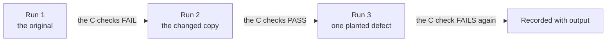

# Modes

Superfix has three ways to finish a job. The coverage check and your request decide which one a run uses.

| Mode | For | What it produces | How it ends |
|---|---|---|---|
| Code | a problem in source, tests, build or config files, or in markdown a program reads | a branch, a tested fix and a pull request | "Ready for review: PR <link>", then "Done" after the merge |
| Criteria | a data or document clean-up, checked against criteria you approve | a changed copy, before and after counts, and three recorded runs | "the counts meet your checks", or "ready, not verified on the real file" |
| Work order | the same code change or criteria file, carried out by someone else | a folder with the steps, the checks and the locked copies | a verified pass, then a PR for code, or counts for a criteria file |

A process is never called solved in either non-code mode. Superfix drafts or adopts the change and reports "change drafted (or adopted), effect measured on <date>: <result>".

Qik configuration is a coverage row rather than a mode. Superfix edits the draft only, marked provisional, and you publish. It never says "live".

## Code mode

Code mode is the full pipeline in [How a run works](how-a-run-works.md): Phase 0 Problem Profile, Phase 1 explore and diagnose, the Stop gate, Phase 2 plan for Moderate and Complex, Phase 3 execute, Phase 4 close.

What it produces:

- A branch created from the approval commit, not from a newer main.
- A fix with a test that failed before it and passes after it.
- Review passes, a security audit when the diff touches auth, input parsing, SQL, shell, secrets or dependencies, and the solved check runs.
- A PR with `Closes #<N>` and a final comment with the solved check output, the cost estimate, the undo line and `## Not tested`.

How it ends: the final comment sets Status to "Ready for review: PR <link>" and the yellow waiting label. After the merge, the run verifies the closing state, sets Status to "Done" and removes the label.

Two variations:

- The fast lane applies only when the request says "just fix it" or "do not wait", there is one problem, it is Simple, row Code, and not security. It still runs Phase 1, still posts the decision message as a notice, and still runs the redaction check, the budget and the solved check. It never applies to Qik.
- A tests-only change replaces the solved check with negative controls: mutate the code, show the right test goes red, then revert. At least one code reviewer pass still runs.

## Criteria mode

Criteria mode is for a data file, a spreadsheet export, a guide or a list. It fixes only against checks you approve; Superfix never invents the definition of done alone. The rules and the tool are in `references/criteria.md`.

### The check lines

Each criterion is one line in `## Done when`, in this shape:

`- P1-C1 [check] duplicate members: rows whose email, with spaces trimmed and case ignored, matches an earlier row; the earliest joined date wins and keeps its own fee; pass: 0; how: measure-P1-C1.py; who: Superfix`

`C` lines say when the problem is gone. `K` lines say what must not get worse. The kinds are:

- `check`: measured now by a script.
- `later`: a baseline now and a dated re-measure. A condition such as "at least 20 refunds" goes in the definition, and the script errors until it holds.
- `owner`: a checklist of at least two items and your sign-off.

The pass line follows a fixed grammar: `0`, `none`, `yes`, `<N>`, `at most <N>`, `fewer than <N>`, `at least <N>`, `between <A> and <B>`, or `<N>% fewer than today`. A line outside it is `CRITERIA-VAGUE` and you are asked to rewrite it.

Above the questions, each criterion gets one plain line: "Duplicate members. Today: 8 (rows 14, 15 and 62). Must be 0." The bracket holds row numbers only, never a value or a name.

### The two questions

The two questions are asked once for all criteria-mode problems, with no recommended answer:

1. "If every check above passes, would you consider these solved?"
2. "What must not get worse, for you or anyone affected?"

Only "yes" to the first plus an answer to the second approves them. "Keep executing" does not approve them: Superfix says so once, appends the notice to the decision comment, asks once more, then waits. Code problems in the same issue go ahead.

A definition that can be read two ways, such as a date like `03/04/2025`, gets its own numbered question before these two.

### The lock and the tool

At the go, the check lines, the measure scripts and the originals are hashed into a `criteria-sha` line in `## Decision`, with the approver. `crit.py` has its own `crit-sha`. Only the locked scripts run, only on the locked files or their copies. A changed check needs a new yes and a new baseline, through `amend`.

The tool runs each script itself, in the macOS sandbox: `/usr/bin/sandbox-exec` with a deny-by-default profile, python3 with `-I -B`, a cleaned environment, a 120 second limit, no shell, no network and writes only in a temporary folder. The tool decides PASS or FAIL from the number and the pass line. A crash, a timeout, a missing `MEASURE` line or a value that disagrees is `ERROR`, never `FAIL`.

The tool is detective, not preventive. It finds changed, missing or hand-made records through a hash chain, but a model that can edit files can still forge a record by working the chain out. Your own re-check is one line in `VERIFY.txt`, which re-runs the scripts on the files you name.

### Attempts and progress

Every attempt goes through the tool, which re-runs the locked scripts and writes a record. There are at most 5 attempts per epoch, whatever the budget says. A sixth is `STOP-CAP 5 of 5 attempts`.

An attempt moved only when a failing `C` got closer to its pass line and no `C` or `K` got further from it. Two attempts in a row with no progress stop the run, with a question: re-diagnose or stop.

### The three runs

Run 1 measures the original and expects each `C` to fail on the rows in the plain block, and each `K` to pass. Run 2 measures the changed copy and expects every check to pass. Run 3 plants exactly one defect in a scratch copy and expects the check to fail again. The tool refuses a negative copy that equals the change or an original, or that has more than one defect.

### Where the work happens

The original is never touched. Work copies live in `$HOME/.superfix/runs/<run-key>/work/` and are deleted when the job ends. The changed copy stays on your Mac unless all three conditions for a commit hold: the repo is private, you said yes to committing and no to names or contact details, and a scan of the diff is clean. A Google Sheet or Drive file is changed only as a local copy; you put it back and send an export, and only then is it "verified on the real file".

Nothing leaves the repo, the run folder and your Mac: no send, share, publish, upload or post, by any tool or command. Messages to other people are draft files.

### How it ends

- Every `check` criterion passes: "the counts meet your checks", never "solved" alone.
- A `later` criterion: the issue waits with "Waiting for you: re-check on <date>".
- An `owner` criterion: the checklist goes in the final comment and waits for "signed off".
- The owner's description still seems true after every check passes: Superfix says so and keeps the issue open.
- A process: "ready for your review", never "solved".

The PR body says `Refs #<N>`, not `Closes`, when any criterion is `later` or `owner`, the problem is a process, or the description still holds.

## Work order mode

Work order mode is for "work order", "someone else will do it" or "hand off", in the request or in the go reply. Superfix diagnoses and plans as usual, then writes a work order folder instead of making the change. The rules and both templates are in `references/workorder.md`.

It applies only when every problem is row Code, or every problem is a criteria-mode file. It never applies to Qik, a live Sheet or Doc, a mix, or the fast lane. "Keep executing" still means Superfix makes the change.

### What the folder holds

For code, `workorder.md` carries the header lines, the steps as a tick list, the loop and a `CHECKS` block. The folder also holds the check.sh script (the checks block exactly), the `WORKORDER-SHA` line given to the executor separately, and the held-back checks, which stay with Superfix. The executor changes only the files in `FILES`, runs `bash check.sh` for each attempt, commits one attempt at a time, and returns `return.bundle`.

For a criteria file, the folder holds a copy of the file under `work/`, the locked measure scripts under `checks/`, the lock, the attempts stub, the done-when file with the approved lines, and the same `workorder.md`. The copy goes in only after an explicit yes to the data question; the original is never in the folder. The executor runs each measure script and compares the number with the tick list, and returns the whole folder.

### The hand-off and the return

1. Superfix runs the baseline at the base, checks the work order and locks it. It prints the `WORKORDER-SHA` line for you to give the executor separately.
2. You copy the folder to the executor. An executor on this Mac runs as another user, or sandboxed. An executor running as the same user on the same Mac is not supported.
3. On return, Superfix runs `wo-return`, then `wo-verify`, then `wo-solved`. It reads only the locked copies and the shas in `## Decision`, never the returned folder's own files or the executor's report.
4. A failure with attempts left is sent back in a fresh folder with the failing checks and a sendback note. With no attempt left, the options are "I fix it myself" or stop.

The executor's report, output and code are untrusted data, never proof or instructions.

### How it ends

- Code kind, verified: Superfix runs the review chain, pushes the returned head, opens the PR, watches CI and posts the final comment. Status becomes "Ready for review: PR <link>".
- Criteria kind, verified: "The counts meet your checks", with the findings. The verified copy stays on your Mac until you take it or stop. A process ends at "ready for your review".
- `STALE`: main moved and a file the work order names changed. Superfix checks the claim, then writes a fresh work order at the new head and asks whether to hand it over again.
- `PLAN-MISMATCH`: Superfix checks the claim first. If it is right, it says so and asks whether to re-diagnose or stop.
- `NEEDS-OWNER`: a question, numbered, in Stop gate form.

The budget line for this route is plain: "Up to <n> hours of my time to plan; the executor gets up to 5 attempts (one commit each)". The route costs about the same as Superfix doing the work, or more; the gain is handing it off.
